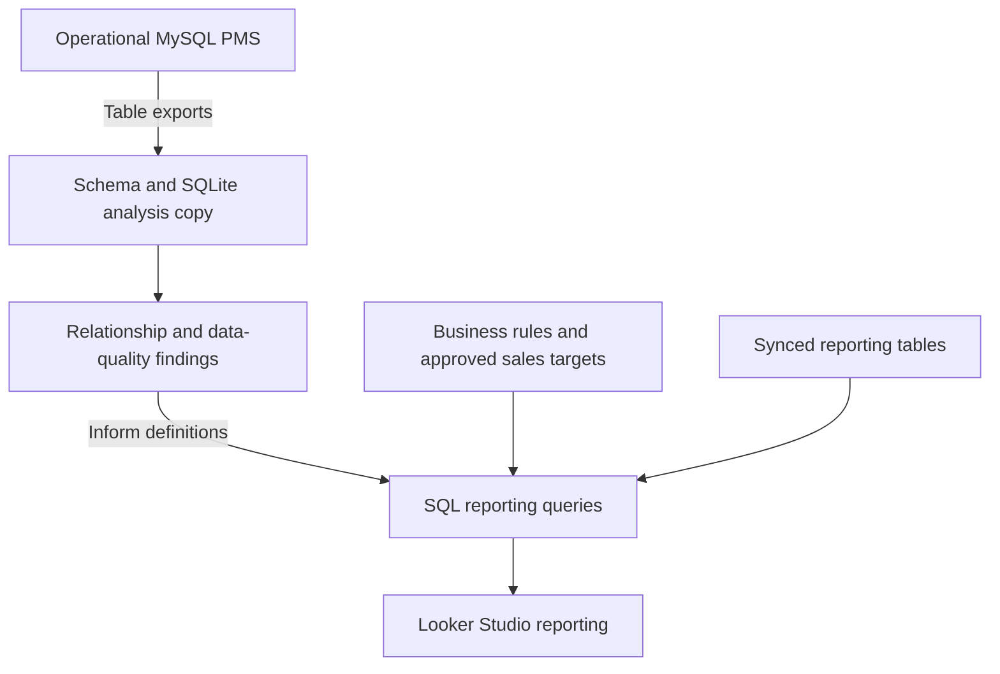

# Making an 86-table PMS usable for commercial reporting

**Oka Suprayana | Business analysis, SQL and financial reporting**

A hospitality reporting project connecting an operational MySQL property management system (PMS) to clearer commercial reporting. The work combined schema reconstruction with decisions about revenue timing, sales attribution and target aggregation.

**Scope:** 86 tables documented; a local SQLite analysis copy; SQL reporting definitions for Looker Studio. Company records and identifying details are omitted from this case study.

## The problem

The database contained the information the business needed, but the structure alone did not explain how to use it. A field named like an ID could contain a text key. A reservation could have several related payment records. A property's operating budget could appear in a sales report even though it was not a sales target.

These were consequential differences. Joining on the wrong key could lose channel attribution. Joining several child records could multiply booking rows. Adding a repeated budget across channels could inflate the denominator of a sales-achievement metric.

My focus was to connect the data model to the business question: what does each row represent, who receives credit, which date determines the reporting period, and which numbers can safely be added?

## Reconstruct the model before building the report

The schema-recovery work covered 86 CSV table exports. Its outputs were a schema file, a queryable SQLite copy and a database guide describing relationships and exceptions. The original verification recorded matching source and loaded row counts for every table.

One useful finding was that a reservation's channel reference contained a slug rather than the channel table's numeric ID. The join needed the text key. Other findings included missing parent records and sentinel values that could not be treated as valid foreign keys.

The SQLite copy supported local inspection and comparison. It was an analysis tool, not a replacement for the operational MySQL application.

*Conceptual architecture. The analysis copy informs the reporting logic; this diagram does not claim that it feeds the live dashboards or that I built the synchronization service.*

## Make the reporting rules explicit

| Issue | Decision reflected in the reporting work |
|---|---|
| A join creates several rows for one booking | Reduce related inquiry-payment records to one row per inquiry before joining, instead of relying on a final wide `DISTINCT`. |
| Property budgets repeat across booking channels | Build the sales summary at account-manager/month grain and use approved quarterly sales targets. |
| A month has a target but no revenue | Preserve the target row with a full outer join. Missing targets remain null. |
| A stay crosses a month boundary | Allocate the booking amount across stay nights for the stay-date view. |
| Sales activity needs a different time basis | Use a separate guaranteed-date view that assigns the booking amount once to its guarantee month. |
| Channel ownership changes | Distinguish the channel's current tag from the tag stored on the booking. Keep unresolved attribution visible as Unassigned. |

The target model illustrates why grain matters. A quarterly target is divided into three monthly slices. Those monthly slices can be summed; the full quarterly target repeated beside each month cannot.

The two revenue views also answer different questions. Stay-date allocation describes the distribution across the stay period; guaranteed-date reporting describes when bookings became guaranteed. Their totals need not match within the same calendar window.

## What the work established

The retained artifacts show a documented 86-table schema, an analysis copy with recorded row-count reconciliation, and reporting queries with explicit rules for joins, attribution, dates and targets. A later channel audit recorded no conflicts against the approved channel-assignment list within its tested scope, while retaining an Unassigned pool and event-related cases for human review.

This is a reporting-correctness case study. It does not attribute company revenue growth to the SQL work, claim a measured query-speed improvement, or present a historical audit as a guarantee about today's data.

The central lesson: a dashboard can execute successfully and still answer the wrong question. Defining grain, ownership and timing is part of the analysis itself.
